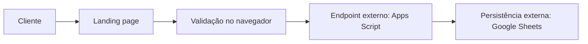

# Monica Hair — Landing Page e Solicitação de Agendamento

> **Case #001 da Vitrine Inteligente** — solução digital para apresentar os serviços da Monica Hair, facilitar o contato pelo WhatsApp e organizar solicitações de atendimento.

## Visão geral

A Monica Hair é uma profissional da beleza que atende no Tatuapé, em São Paulo. Este projeto organiza sua presença digital em uma landing page responsiva, com informações sobre serviços, localização, canais de contato e um formulário de solicitação de horário.

O formulário envia os dados para um endpoint externo do Google Apps Script configurado em `config.js`. O código desse serviço e a configuração do Google Sheets não fazem parte deste repositório. Por isso, este repositório permite avaliar a integração implementada no site, mas não auditar o processamento ou confirmar a persistência dos registros no serviço externo.

**A solicitação não confirma nem reserva automaticamente um horário.** A confirmação depende do contato posterior com a profissional.

## Demonstração

[Acessar a landing page Monica Hair](https://hair-by-monica.vercel.app/)

## O que a página oferece

- Apresentação da profissional, dos serviços e dos diferenciais.
- Botões de contato e agendamento pelo WhatsApp.
- Formulário para solicitar data, horário e procedimento.
- Informações de endereço, horário de atendimento e acesso ao Google Maps.
- Conteúdo estruturado para SEO local, metadados para compartilhamento e dados estruturados de salão de beleza.
- Layout responsivo e imagens com textos alternativos.

## Fluxo do formulário



O navegador valida os campos e envia a solicitação ao endpoint definido em `config.js`. A disponibilidade da agenda, a confirmação do horário e o registro final dependem do serviço externo.

## Validações presentes no site

O JavaScript do formulário verifica campos obrigatórios, formato do celular, dia da semana, horário informado e procedimento selecionado. A data mínima também é ajustada para o dia atual.

Essas verificações acontecem no navegador e não substituem validações no serviço que recebe os dados. O sistema ainda não consulta a disponibilidade real da agenda nem impede, por conta própria, conflitos entre solicitações.

## Escopo atual e limites conhecidos

| Situação | Escopo |
|---|---|
| Disponível no site | Landing page, conteúdo dos serviços, localização, links para WhatsApp e formulário de solicitação |
| Dependência externa | Envio para endpoint configurado do Google Apps Script |
| Fora do controle deste repositório | Código do Apps Script, permissões e estrutura do Google Sheets, disponibilidade real da agenda e persistência em produção |
| Não oferecido pelo fluxo atual | Reserva automática, prevenção comprovada de conflitos, integração com calendário e confirmação automática por WhatsApp |

A página informa que às segundas-feiras o atendimento é limitado a três clientes. Esse limite é apresentado como informação ao cliente; sua aplicação automática à agenda não é comprovada pelo código deste repositório.

## Tecnologias

| Camada | Tecnologia |
|---|---|
| Interface | HTML, CSS e JavaScript |
| Hospedagem | Vercel |
| Processamento da solicitação | Google Apps Script externo, apontado por `config.js` |
| Persistência planejada/configurada fora do repositório | Google Sheets |

## Estrutura do projeto

```text
.
├── index.html
├── config.js
├── css/
│   └── style.css
├── js/
│   ├── agendamento.js
│   └── script.js
├── images/
└── docs/
```

## Executar localmente

O projeto é estático e não exige instalação de dependências para visualizar a página.

1. Clone o repositório:

   ```bash
   git clone https://github.com/apduartte/hair-by-monica.git
   cd hair-by-monica
   ```

2. Inicie um servidor local simples:

   ```bash
   python -m http.server 8000
   ```

3. Abra [http://localhost:8000](http://localhost:8000).

O envio do formulário depende do endpoint externo configurado em `config.js`. A visualização local da página, por si só, não comprova o funcionamento do Apps Script ou do Google Sheets.

## Documentação do case

A documentação registra o contexto, o fluxo comercial, os requisitos e a evolução arquitetural:

- [01 — Baseline](docs/01-baseline.md)
- [02 — Funil](docs/02-funnel.md)
- [03 — KPIs](docs/03-kpis.md)
- [04 — Taxonomia de eventos](docs/04-event-taxonomy.md)
- [05 — Processo atual da agenda](docs/05-as-is-agenda.md)
- [06 — Requisitos da agenda](docs/06-requisitos-agenda.md)
- [07 — Arquitetura proposta](docs/07-to-be-arquitetura.md)
- [08 — Fluxo técnico](docs/08-fluxo-tecnico.md)
- [09 — Contrato de agendamento](docs/09-contrato-agendamento.md)
- [10 — Especificação técnica](docs/10-especificacao-tecnica.md)

Os documentos de arquitetura e especificação descrevem decisões e evoluções propostas. Eles não devem ser interpretados, por si só, como evidência de que todos os componentes foram implementados ou publicados.

## Próximas melhorias

1. Confirmar e documentar o comportamento do endpoint e o registro externo usando dados de teste.
2. Aplicar no serviço de processamento as validações de data, horário, duração e disponibilidade.
3. Prevenir conflitos e aplicar regras operacionais, incluindo o limite informado para segundas-feiras.
4. Exibir aviso de privacidade junto ao formulário e documentar acesso e retenção dos dados.
5. Avaliar integração com calendário e confirmação após validação do processo real.
6. Registrar testes de navegação, formulário, acessibilidade e responsividade.

## Autoria

Projeto desenvolvido por **Ana Paula Duarte** como case prático da **Vitrine Inteligente**, aplicando análise do problema, desenvolvimento web, integração e documentação técnica.

**Princípio de trabalho:** Think → Decide → Build → Prove.
